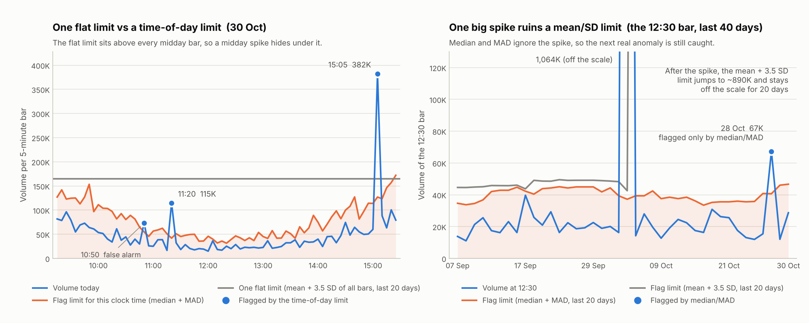

# Time-of-Day Volume Anomaly Detector

A small Python tool that finds **unusual trading volume** in intraday data (for example 5-minute bars).

It answers one question for every bar: **"Is this volume strange for this time of day?"**

- Written in plain Python (numpy, pandas, matplotlib).
- One file: `tod_volume_anomaly.py`.
- Works on a whole history (research) or one bar at a time (live feed).
- Built for learning and research. It is **not** a compliance system, and an alert is **not** proof of anything (see [Limits](#10-limits-please-read)).

---

## 1. The problem in one minute

Volume is not flat during the day. It is **high at the open and the close and low at lunch time**. Plotted, it looks like the letter **U**.

So a simple rule like "flag anything above the daily average" breaks:

- It flags the open and close **every single day** (too many false alarms).
- It **misses** a real spike at midday, because that spike is still smaller than a normal opening bar.

This tool fixes that with two ideas.

---

## 2. The two ideas

### Idea 1: compare with the same time on earlier days

Think of a shop. It is busy when it opens and when it closes, and quiet at lunch.

- 100 customers at 9:15 am is normal.
- 100 customers at 12:30 pm is strange.

So the 12:30 bar is compared **only with the 12:30 bars of the last 20 days**. Never with the whole day mixed together. The tool keeps a separate "normal" for every clock time.

### Idea 2: use the median, not the average

Ten people in a room earn about ₹50,000 a month. Then a billionaire walks in.

- The **average** jumps to crores and is now useless.
- The **median** (the middle value) barely moves.

One huge volume spike does the same thing to an average. After it, the average (and the standard deviation) stops spotting the next spike. The median does not have this problem.

---

## 3. The maths, step by step

For one bar, for example **today's 12:30 bar**:

| Step | What we do | In plain words |
|---|---|---|
| 1 | Take the 12:30 volume of the **previous 20 days** | Only yesterday and earlier. Today is never used to judge itself (no peeking at the future). |
| 2 | **Median** = the middle value | "What is normal for 12:30?" |
| 3 | **MAD** = the median of `|each value − median|` | "How far do values usually sit from normal?" (the normal wobble) |
| 4 | **Score** = `0.6745 × (today − median) / MAD` | "How many wobbles above normal is today?" |
| 5 | If **score > 3.5**, flag the bar | 3.5 is the usual cut-off for outliers (Iglewicz and Hoaglin, 1993) |

The same thing as a formula:

```
MAD   = median( |x_i − median(x)| )
score = 0.6745 × (x_today − median) / MAD          flag if score > 3.5
limit = median + 3.5 × MAD / 0.6745                 (the volume where the score reaches 3.5)
```

**Why 0.6745?** A MAD is naturally smaller than a standard deviation. Multiplying by 0.6745 (which is 1 ÷ 1.4826) puts the score on the same scale as an ordinary z-score for bell-shaped data. So "3.5" here means roughly "3.5 standard deviations".

### A worked example (made-up numbers)

The 12:30 volume on the last 10 days: `18,000  22,000  20,000  25,000  19,000  21,000  23,000  17,000  20,000  24,000`

| | Value |
|---|---|
| Sorted | 17,000 18,000 19,000 20,000 **20,000 21,000** 22,000 23,000 24,000 25,000 |
| **Median** (middle of the two centre values) | **20,500** |
| Distances from the median | 2,500 1,500 500 4,500 1,500 500 2,500 3,500 500 3,500 |
| **MAD** (median of those distances) | **2,000** |
| Today's 12:30 volume | 60,000 |
| **Score** = 0.6745 × (60,000 − 20,500) / 2,000 | **13.3** → flagged |
| **Limit** = 20,500 + 3.5 × 2,000 / 0.6745 | 30,878 (anything above this is flagged) |

### Why the median wins (same example, one bad day)

Now suppose one earlier day had a freak 400,000 at 12:30. Today is still 60,000.

| Method | Score for today's 60,000 | Result |
|---|---|---|
| Mean and standard deviation | **0.01** | Missed. The freak day swallowed the signal. |
| Median and MAD | **13.0** | Still caught. |

### The safety net (MAD floor)

If the last 20 days happen to be almost identical, the MAD becomes tiny and scores explode. So the MAD is never allowed to fall below **5% of the median** (or 1 share). You can change this in the settings at the top of the file.

---

## 4. Setup, step by step

1. **Install Python 3.13 or 3.14** from python.org.
   On the first installer screen, tick **"Add python.exe to PATH"**. (Avoid brand-new versions; some libraries may not support them yet.)
2. **Close and reopen** your terminal or VS Code.
3. **Install the libraries** (one time):
   ```
   python -m pip install numpy pandas matplotlib
   ```
4. **Put `tod_volume_anomaly.py` in a folder** and open a terminal in that folder.
   (You can rename the file. Just use your file's name in the commands below.)

---

## 5. Run it, step by step

### Step 1: run the demo (made-up data, no files needed)

```
python tod_volume_anomaly.py
```

Add a chart:

```
python tod_volume_anomaly.py --plot demo.png
```

The demo builds 120 days of fake 5-minute volume with a U-shape and **hides 5 anomalies** in it. Because we know the right answers, we can score each method.

### Step 2: run it on your own data

Make a CSV with two columns, one row per bar:

```
timestamp,volume
2026-10-26 09:15:00,81234
2026-10-26 09:20:00,64310
...
```

Then:

```
python tod_volume_anomaly.py --csv bars.csv
```

Rules for the CSV:
- **One stock per file.**
- Use **one consistent clock** (the exchange's local time). If timestamps shift, "12:30" stops meaning the same thing every day.
- Any bar size works (1, 5, 15 minutes), as long as it is the same all through the file.
- Remove pre-open auction rows or special sessions if they are in the file.

### Options

| Option | What it does | Default |
|---|---|---|
| `--csv FILE` | Score your own data | demo |
| `--last-days N` | List alerts only from the latest N days | all |
| `--log` | Do the maths on log(volume) (see [section 8](#8-the---log-option)) | off |
| `--window N` | Days of history kept for each clock time | 20 |
| `--min-days N` | Days needed before scoring starts | 10 |
| `--threshold X` | Score needed to flag a bar | 3.5 |
| `--out FILE` | Save the full scored table to a CSV | none |
| `--plot FILE` | Save the demo chart (demo only) | none |

Example, a quieter setting for real data:

```
python tod_volume_anomaly.py --csv bars.csv --log --window 40 --min-days 20 --last-days 5
```

The first `min-days` days of any file are **not scored**. The tool needs history first.

---

## 6. How to read the output

### 6.1 The alert table

```
WHEN             VOLUME    NORMAL     LIMIT  x NORMAL   SCORE  LEVEL    NOTE
28 Oct 12:30     67,311    19,027    40,683      3.5x     7.8  HIGH     HIDDEN anomaly
30 Oct 10:50     73,201    33,872    54,878      2.2x     6.6  HIGH     false alarm
30 Oct 11:20    114,625    26,038    41,903      4.4x    19.5  EXTREME  HIDDEN anomaly
```

*(made-up data)*

| Column | Meaning |
|---|---|
| **WHEN** | The bar's time |
| **VOLUME** | What actually traded |
| **NORMAL** | The median for this clock time over the recent days |
| **LIMIT** | The volume above which a bar is flagged |
| **x NORMAL** | Volume ÷ normal. "3.5x" means 3.5 times the usual |
| **SCORE** | The modified z-score. 3.5 is the flag line. Higher means stranger |
| **LEVEL** | WATCH (3.5+), HIGH (5+), EXTREME (10+) |
| **NOTE** | Demo only: says if the flag was a hidden anomaly or a false alarm |

Two things to notice:
- A high **score** does not always mean a high **x NORMAL**. If a stock is usually very steady at that time, even 2.2x normal can score high (see the 10:50 row).
- **LEVEL is only a label I picked.** There is no market standard for these tiers. Real teams set them from their own data and from how many alerts analysts can review. Change `LEVELS` at the top of the file.

### 6.2 The demo sections

| Section | What it shows | How to read it |
|---|---|---|
| **1. Scoreboard** | Each method: anomalies caught, false alarms, false alarms per day | You want **5 of 5 caught** with **few** false alarms. |
| **2. Hidden anomalies** | Who caught each hidden anomaly | `MISSED` shows where a weaker method fails. |
| **3. What an analyst would see** | The alert table for the last 3 days | The real-life view of the tool. |
| **4. Self-check** | Batch code and live code give the same scores | Should say `OK`. |

Example scoreboard (made-up data):

```
METHOD                                            CAUGHT   FALSE ALARMS  PER DAY
Flat limit (one mean/SD for the whole day)        3 of 5             27     0.34
Same-time mean/SD                                 4 of 5             67     0.84
Same-time median/MAD (plain formula)              5 of 5            142     1.77
Log volume + median/MAD, 40-day window            5 of 5             12     0.15
```

The plain median/MAD method catches everything but raises many false alarms. The log version with a 40-day window catches everything with far fewer.

### 6.3 The summary lines above the table

- **Where in the day**: flags at the open, midday and close, next to each part's share of all bars. A good baseline gives flags in about the same proportion as the bars. If flags pile up at the open or close, the U-shape is not handled well.
- **Days with 4+ flags**: a cluster of flags on one day usually means a busy market day (news, a big move), not one odd bar.

### 6.4 The chart (`--plot`)



- **Left:** one day. The grey flat line is a single limit for the whole day. It sits above every midday bar, so a midday spike hides under it. The orange line is the limit for each clock time. It follows the U and catches the spike.
- **Right:** the 12:30 bar over 40 days. One freak spike sends the mean/SD limit (grey) off the chart for 20 days. The median/MAD limit (orange) barely moves, so the next real anomaly (the 28 Oct dot) is still caught.

### 6.5 What to do with an alert

An alert is a **lead**, not a verdict. Ask:

1. Is it a special day (expiry, results, index rebalance, circuit hit, corporate action)?
2. Did the price move with the volume? A spike with no price move is a different story from one with a big move.
3. Was there news?
4. Did the whole market spike at the same time, or only this stock?
5. Did it repeat on other days or at the same time each day?

---

## 7. Use it in your own code

**Whole history (research):**

```python
import pandas as pd
from tod_volume_anomaly import detect, report

df = pd.read_csv("bars.csv", parse_dates=["timestamp"]).set_index("timestamp")
res = detect(df["volume"], log=True, window=40, min_days=20)

report(res, last_days=5)      # readable summary
flagged = res[res["flag"]]    # only the flagged bars (a pandas table)
```

`res` has one row per bar with these columns: `volume`, `median`, `mad`, `z` (the score), `upper` (the limit) and `flag`.

**One bar at a time (live feed):**

```python
from tod_volume_anomaly import TimeOfDayBaseline

det = TimeOfDayBaseline(window=20)
det.fit(history)                      # history = a pandas Series of past volumes, timestamps as the index

for ts, volume in live_bars:          # each new bar as it arrives
    r = det.on_bar(ts, volume)        # scores it, then adds it to the history
    if r["flag"]:
        print(ts, volume, f"= {volume / r['median']:.1f}x normal, score {r['z']:.1f}")
```

The batch and live versions use the same maths and give identical scores (the demo checks this).

---

## 8. The `--log` option

Volume is **lopsided**: it can never be negative, but it can spike to many times normal. A cut-off that is symmetric (the same distance above and below) fires too often on lopsided data.

Taking the logarithm first makes the data more even. On the made-up data this cut false alarms by roughly **70% to 90%**.

The cost: it is **a bit less sensitive**. A 3x spike only just clears the line (score about 3.7 against 3.5).

Plain volume is the default because it is the formula as originally specified. Try `--log` on your real data and compare.

---

## 9. Settings you can change (top of `tod_volume_anomaly.py`)

| Setting | Default | Meaning |
|---|---|---|
| `THRESHOLD` | 3.5 | Score needed to flag a bar |
| `WINDOW` | 20 | Days of history for each clock time. Longer is steadier but slower to adapt |
| `MIN_DAYS` | 10 | No score until this many days exist |
| `MAD_FLOOR_FRAC` | 0.05 | MAD never below 5% of the median |
| `LEVELS` | 3.5 / 5 / 10 | WATCH / HIGH / EXTREME tiers. **My own labels, change them** |

---

## 10. Limits (please read)

- **The demo uses made-up data.** Its numbers show how the *method* behaves, not how any real market behaves. Test on real bars before trusting any threshold.
- **A volume spike is not misconduct.** Most spikes are news, results, index changes or large investors. This tool finds *unusual*, not *wrong*.
- **Only the high side is flagged** by default. Unusually *low* volume is not reported.
- **One stock at a time.** It does not compare stocks with each other.
- **Thresholds need calibration.** 3.5 is a general statistics rule, not a market standard. Real teams set cut-offs from their own data, per stock or group, against how many alerts they can review.
- **Special days and sessions** (expiry, results, half-days, special sessions) can look strange. Handle them separately.
- **Missing bars:** the batch version keeps an empty slot for a missing bar. The live version just skips it. They agree exactly only when no bars are missing.
- A bar flagged as anomalous is **still added** to its history afterwards. This is fine because the median barely notices one outlier among 20.

---

## 11. Troubleshooting

| Message | What it means | Fix |
|---|---|---|
| `No module named 'numpy'` | The libraries are not installed for this Python | `python -m pip install numpy pandas matplotlib` |
| `'python' is not recognized` | Python is not on PATH | Reinstall Python and tick **Add python.exe to PATH**, or try `py` instead of `python` |
| `externally-managed-environment` | Your Python blocks installs (for example one managed by `uv`) | Make a virtual environment: `python -m venv .venv`, then `.venv\Scripts\python.exe -m pip install numpy pandas matplotlib`, then run with `.venv\Scripts\python.exe tod_volume_anomaly.py` |
| Yellow import warnings in VS Code | VS Code is using a different Python | `Ctrl+Shift+P` → **Python: Select Interpreter** → pick the one you installed into |
| `Index contains duplicate entries` | Two rows share the same date and time | Remove the duplicates from your CSV |

---

## 12. Word list

| Word | Simple meaning |
|---|---|
| **Bar** | Volume traded in one time slice, for example 5 minutes |
| **Clock-time bucket** | All the bars at the same time of day, for example every 12:30 bar |
| **Median** | The middle value when numbers are sorted |
| **MAD** | Median Absolute Deviation. The normal wobble around the median |
| **Modified z-score** | How many wobbles a value sits above normal. Here called the score |
| **Outlier** | A value far away from the others |
| **False alarm** | A flag on a bar that was actually normal |
| **Look-ahead** | Accidentally using future data to judge the past. This tool avoids it |

---

*Reference: Iglewicz, B. and Hoaglin, D. (1993), "How to Detect and Handle Outliers". The 3.5 cut-off and the 0.6745 factor come from there.*
